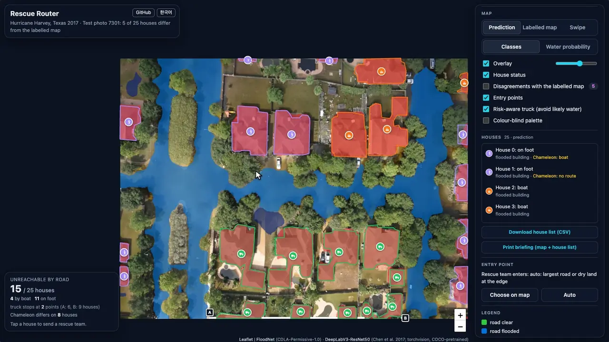
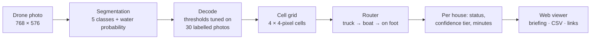
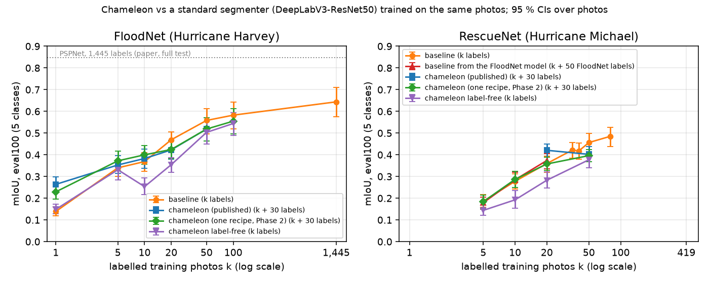

# Rescue Router

[](https://github.com/MarlenMM/rescue-router/actions/workflows/ci.yml)
[](https://marlenmm.github.io/rescue-router/)
[](#results)
[](experiments/phase2/PROTOCOL.md)
[](pyproject.toml)
[](LICENSE)

After a flood, rescue teams fly drones and come back with hundreds of photos, but someone still has to work out
which streets a truck can use and which houses are cut off. **Rescue Router** turns a single drone photo into a flood
map (clear road, flooded road, flooded and dry buildings, water) and then plans how a team reaches **every house**:
by truck on dry ground, by boat across the water, on foot for the last stretch, or not at all (an air team). Every
truck route also gets a confidence tier, so the routes most likely to be wrong are flagged before anyone drives them.

The flood map is learned from **50 labelled photos**, not the thousands of labels a new disaster rarely has.

<p align="center">
  
</p>

**Live viewer: <https://marlenmm.github.io/rescue-router/>**. Two hurricanes, 200 test photos the models never
trained on, the prediction next to the human-labelled map, animated routes with minutes and metres, a printable
briefing for a field team, English and Korean. **Try your own drone photo** maps and routes a photo inside your
browser with a 13 MB model: nothing is uploaded anywhere.

### Measured

| | |
|---|---|
| Flood-map accuracy, all 448 FloodNet test photos, 50 + 30 labelled photos | **mIoU .617** [.583, .652] (Chameleon: .507) |
| Houses shown as truck-reachable that are not ("false safe", the dangerous error) | **6.8 %** (Chameleon: 11.1 %) |
| Houses in the "confident" truck tier that really were truck-reachable | **99.4 %** of 361 (100-photo subset) |
| Cut-off houses found, F1 against the same router on the human labels | **.817** |
| Python router vs. its JavaScript port in the viewer | **bit-identical** on all 400 scene × model pairs |
| A photo mapped and routed in the browser | **0.2–0.7 s** after a one-time 27 MB download |

Brackets are 95 % bootstrap confidence intervals over photos. The 30 extra labelled photos set the decision
thresholds and the router's settings; no test photo was used to choose anything.

Started as the structured-prediction mini-project of KAIST AIC.20000 *Introduction to AI Computing* (Fall 2026), which
set [Chameleon](https://github.com/GitGyun/chameleon), a few-shot "generalist" vision model, as the model to adapt.
The project then asked whether that choice was right, in a **pre-registered** comparison with ordinary fine-tuning on
exactly the same labelled photos ([Results](#results)). The answer changed which model the viewer uses.

---

## Contents

- [How it works](#how-it-works)
- [Results](#results)
- [Limitations](#limitations)
- [Getting started](#getting-started)
- [Repository layout](#repository-layout)
- [Credits and licences](#credits-and-licences)

## How it works



**1. Segmentation.** Every pixel gets one of five classes (clear road, flooded road, flooded building, dry building,
water; anything else is "other"), plus a water probability. Three models, all trained on the same 50 labelled FloodNet
photos (20 for RescueNet):

| model | where it is used | hardware |
|---|---|---|
| **DeepLabV3-ResNet50 ensemble**: 3 training seeds, each averaged over the photo and its flips | the viewer's FloodNet model | CPU, ~4 s per photo |
| **Chameleon** (Kim et al., ECCV 2024), bias and matching-module fine-tuning; on FloodNet, SAM redraws the building outlines | the viewer's RescueNet model | GPU, ~17 s per photo |
| **LR-ASPP-MobileNetV3**, self-trained on unlabelled photos with its own confident pseudo-labels, exported to ONNX | "Try your own drone photo", in the browser | browser, < 1 s |

**2. Routing** ([`src/router.py`](src/router.py), ported bit for bit to [`app/js/router.js`](app/js/router.js)). A
shortest-path search over (cell, mode) states on 4 × 4-pixel cells. A truck drives on dry roads, and slowly across dry
yards where the model is confident there is no water; it can launch a boat into water, and either can drop the team
off to walk the last stretch, but never back into a vehicle. Vehicles have a width (a truck needs about 2.5 m between
buildings, a boat 1.6 m), parked cars are bridged, tree canopy over water is crossable by boat, and nothing squeezes
diagonally between two touching obstacles. Each house ends up **truck**, **boat**, **on foot** or **no route**.

**3. Confidence.** The prediction is routed twice, with the normal off-road rule and a cautious one that refuses
ground with even a 5 % chance of water. Houses a truck still reaches are **confident**; the rest are marked
**check first**. Both gates were chosen on the labelled tuning photos and confirmed on 100 more.

**4. Viewer** ([`app/`](app/), static, no server). Leaflet map with the prediction, the human-labelled map and a swipe
between them; animated truck → boat → foot routes with minutes and metres; a water-probability layer; a choice of
entry point; a model switch that shows the other model on the same photo and marks the houses the two models route
differently; a printable briefing that opens with a dispatch plan; CSV export; links that reopen exactly the same view;
keyboard navigation, a colour-blind palette and a phone layout.

## Results

### The question

Chameleon is built to learn new dense-prediction tasks from a handful of examples. The obvious control was missing:
an ordinary segmentation network, pretrained on everyday photos and fine-tuned on **exactly the same labelled
photos**. Before any GPU run, the questions, the single training recipe, the runs, the evaluation and the decision
rules were written down and committed ([`experiments/phase2/PROTOCOL.md`](experiments/phase2/PROTOCOL.md); five
amendments, each committed before the runs it concerns, and a log of every deviation). Four Kaggle T4 sessions (20.5
hours) ran the study. Each Chameleon session first checked that the submitted model still reproduced its published
predictions (largest difference 0.5/255) and would have stopped otherwise.

<p align="center">
  
</p>

### What it found

Differences are paired photo by photo on the full test sets (95 % CIs); negative means Chameleon is ahead.

| labelled training photos | FloodNet (Hurricane Harvey) | RescueNet (Hurricane Michael) |
|---|---|---|
| 1 | **−.122** [−.139, −.106] Chameleon | – |
| 5 | **−.023** [−.045, −.003] Chameleon | −.008 [−.025, +.009] level |
| 10 | −.020 [−.043, +.004] level | **−.023** [−.040, −.006] Chameleon |
| 20 | **+.028** [+.001, +.054] DeepLabV3 | Chameleon ahead on 2 of 3 photo draws |
| 50 | **+.074** [+.045, +.107] DeepLabV3 | **+.060** [+.014, +.108] DeepLabV3 (100-photo subset) |

- **Ordinary fine-tuning wins from about 20 labelled photos**, and it routes more safely: at 50 photos a single
  DeepLabV3 finds more cut-off houses (F1 +.060 [+.015, +.115]) with fewer false-safe houses (8.1 % vs 11.1 %;
  routing along the whole curve: [figure](media/learning-curve-routing.png)).
- **Chameleon wins with very few labels** (1–5 FloodNet photos) and on the second disaster at 10–20 photos. That edge
  comes from its 30 tuning photos: when the standard model may also train on them, it leads at every point
  ([figure](media/learning-curve-total-labels.png)). A tuning-label advantage, not a label-efficiency advantage.
- **Chameleon is much less stable.** Five 50-photo runs (three photo draws, three training seeds): .487 ± .054 for
  Chameleon, .555 ± .014 for DeepLabV3, which was ahead in all five. One Chameleon seed scored .396 after a normal
  training run, so a single few-shot run carries roughly ±.05.
- **The tuning photos were not over-fitted.** On 100 other validation photos the submitted model scores .502 against
  .516 on the 30 it was tuned on, inside the registered limit of .03.
- **Product decision.** The registered rule picked a Chameleon + DeepLabV3 probability mix (.591, false safe 5.2 %),
  statistically level with the CPU-only DeepLabV3 ensemble (.617, false safe 6.8 %). The viewer uses the ensemble on
  FloodNet because it needs no GPU, and keeps Chameleon on RescueNet, where a registered fairness check against the
  same ensemble kept it ahead (.421 vs .373 on the 100-photo subset, paired −.048 [−.083, −.014]).

### Final models, FloodNet test (448 photos)

| model | labelled photos | mIoU [95 % CI] | cut-off houses F1 | false safe | runs on |
|---|---|---|---|---|---|
| **DeepLabV3 ensemble + flips** (viewer) | 50 + 30 | **.617** [.583, .652] | .817 | .068 | CPU, ~4 s |
| Chameleon + DeepLabV3 mix (registered choice) | 50 + 30 | .591 [.556, .627] | .844 | .052 | GPU + CPU |
| LR-ASPP-MobileNetV3, self-trained (browser) | 50 + 30 | .601 | – | – | browser, < 1 s |
| DeepLabV3-ResNet50, one network | 50 | .581 [.545, .617] | .813 | .081 | CPU, 0.5 s |
| Chameleon (the course model) | 50 + 30 | .507 [.474, .538] | .752 | .111 | GPU, 17 s |
| DeepLabV3-ResNet50, all labels | 1,445 | .728 | | | CPU |
| PSPNet, FloodNet paper (same classes) | 1,445 | .848 | | | |

Per-class results, the routing evaluation, the label budget, the variance study and the full deviation log are in
the [model card](MODEL_CARD.md), the [data card](DATA.md) and the protocol. Along the way, 11 FloodNet test photos were
found to label dry lawns and river banks as water ([`splits/floodnet_label_errors.tsv`](splits/floodnet_label_errors.tsv));
every number is also reported without them.

## Limitations

**Research code, not a tool for operational rescue decisions.**

- On FloodNet, about 1 in 15 houses the viewer shows as truck-reachable is not, mostly where the route crosses
  shallow or muddy water the model read as land. Only the "confident" tier was reliable in testing, and it covers fewer houses.
- Flooded roads are the weakest class (IoU about .47 for the best model, .31 for Chameleon).
- Trained on suburban Texas and Florida, photographed straight down from FloodNet's height. On unseen OpenAerialMap
  photos from India and Jamaica, water was found well but flat concrete and damaged roofs were mostly missed
  ([`demo/uploads/`](demo/uploads/README.md)).
- Single photos without georeference: routes start at the photo's edge, and distances assume FloodNet's ground scale.
- The routes are scored against the same router on the human pixel labels, not against field-checked access.

## Getting started

**Run the viewer locally** (no install; everything is in [`docs/`](docs/)):

```bash
git clone https://github.com/MarlenMM/rescue-router.git && cd rescue-router
python3 -m http.server 8766 --directory docs
```

then open <http://localhost:8766/#s=rescuenet_12195&h=8&m=gt> (a canal row reached by truck, boat, then on foot).

**Install and test** (Python 3.12 with [uv](https://docs.astral.sh/uv/), Node.js ≥ 20):

```bash
uv sync --locked                      # CPU environment from uv.lock (or: pip install -r requirements.txt)
uv run pytest -q                      # 90 tests; those that need the datasets or prediction caches skip themselves
node --test app/test/*.test.mjs       # router parity with Python on all 400 scenes, upload scene builder, Korean UI
```

**Map your own photos with the trained models** (CPU; the weights are attached to the
[v1.0.0 release](https://github.com/MarlenMM/rescue-router/releases/tag/v1.0.0)):

```bash
gh release download v1.0.0 -R MarlenMM/rescue-router -D weights      # or download them from the release page
uv run python src/gradio_viewer.py --live_tta --live_decode weights/baseline_deeplabv3_r50_50shot_s0_ens3_tta.json \
  --live_baseline weights/baseline_deeplabv3_r50_50shot_s0.pt,weights/baseline_deeplabv3_r50_50shot_s1_sup0.pt,weights/baseline_deeplabv3_r50_50shot_s2_sup0.pt
```

This serves the viewer on <http://127.0.0.1:7860> with uploaded photos mapped by the viewer's FloodNet ensemble
(~4 s per photo on a CPU).

**Prepare the data.** Download [FloodNet](https://github.com/BinaLab/FloodNet-Supervised_v1.0) and
[RescueNet](https://springernature.figshare.com/collections/RescueNet_A_High_Resolution_UAV_Semantic_Segmentation_Benchmark_Dataset_for_Natural_Disaster_Damage_Assessment/6647354/1),
run `python src/prep_data.py --floodnet_raw <dir> --rescuenet_raw <dir> --out <dir>` (768 × 576 photos, five-class
labels, the fixed splits) and unpack its archives into `$RR_DATA` (default `~/rr_data`). Every split and support set
is committed in [`splits/`](splits/) and [`supports/`](supports/) with SHA-256 sums.

**Train the standard segmenter** on the same 50 photos (CPU or Apple GPU; no validation labels are used):

```bash
for s in 0 1 2; do uv run python src/baseline_seg.py --shot 50 --seed $s --support_seed 0; done
uv run python src/gradio_viewer.py --live_tta --live_baseline \
  results/baselines/ckpt/baseline_deeplabv3_r50_50shot_s0.pt,results/baselines/ckpt/baseline_deeplabv3_r50_50shot_s1_sup0.pt,results/baselines/ckpt/baseline_deeplabv3_r50_50shot_s2_sup0.pt
```

The first line trains the ensemble's three networks (three seeds, the same 50 photos) and writes their predictions
on the test set; the second serves the viewer with uploads mapped by your ensemble. Its decode thresholds come from
the 30 tuning photos ([`src/baseline_avg.py`](src/baseline_avg.py), then [`src/decode_tune.py`](src/decode_tune.py);
`--live_decode`).

**Chameleon** needs a GPU and the course's meta-trained checkpoint (from the
[course starter](https://github.com/GitGyun/AIC200-Project-StructuredPrediction)): fine-tuning and prediction are
[`src/finetune.py`](src/finetune.py) and [`src/predict.py`](src/predict.py), run on Kaggle T4s by
[`kaggle/`](kaggle/). The executed end-to-end notebook is [`notebook/rescue_router_executed.ipynb`](notebook/rescue_router_executed.ipynb).

**Rebuild every number.** `python src/rebuild_all.py` recomputes every table, report, figure, viewer scene and the
viewer itself from the prediction caches on a CPU (~30 min on 8 cores) and checks the headline numbers against the
published ones; all randomness is seeded. The caches (~14 GB) are not in the repository.

## Repository layout

| path | contents |
|---|---|
| [`src/`](src/) | data preparation, fine-tuning and prediction, the standard-segmenter baselines, decoding, metrics, the router, evaluation and bootstrap CIs, reports, viewer export, the Gradio apps |
| [`src/tests/`](src/tests/) | Python tests (router, metrics and decode, scene packing, study tooling, data-leak guards, resumable training) |
| [`app/`](app/) | the web viewer: plain HTML/JS, vendored Leaflet and onnxruntime-web, the JS router, the in-browser scene builder, and its tests |
| [`docs/`](docs/) | the built viewer served by GitHub Pages (`src/build_viewer.py`) |
| [`experiments/`](experiments/) | the pre-registered protocol and the small studies it led to |
| [`kaggle/`](kaggle/) | GPU sessions: kernel builders, the pinned environment check, the finishers that download and post-process |
| [`splits/`](splits/), [`supports/`](supports/) | fixed evaluation splits, labelled-photo draws and the FloodNet label errors, hashed |
| [`notebook/`](notebook/) | the end-to-end notebook (generator and executed copy) |
| [`writeup/`](writeup/), [`slides/`](slides/) | the course write-up (LaTeX and PDF), slides and a 90-second video of the first version |
| [`demo/`](demo/) | photos for live demos (none of them among the viewer's 200), with their sources and licences |
| [`media/`](media/) | README figures and the script that records them from the viewer |
| [`notes/`](notes/) | the working plan and decision log, kept as written during the project |
| [`MODEL_CARD.md`](MODEL_CARD.md), [`DATA.md`](DATA.md) | what the models are and how far to trust them; data sources, licences and splits |

The version handed in for the course is tagged
[`submitted-2026-10-08`](https://github.com/MarlenMM/rescue-router/tree/submitted-2026-10-08).

## Credits and licences

- Code and documentation: [MIT](LICENSE). Data, models and vendored code keep their own licences.
- **Chameleon**: Kim et al., *Chameleon: A Data-Efficient Generalist for Dense Visual Prediction in the Wild*, ECCV 2024
  ([code](https://github.com/GitGyun/chameleon), MIT); meta-trained checkpoint from the course.
- **SAM** ViT-B: Kirillov et al., *Segment Anything*, ICCV 2023
  ([code](https://github.com/facebookresearch/segment-anything), Apache-2.0).
- **DeepLabV3** and **LR-ASPP-MobileNetV3** from [torchvision](https://github.com/pytorch/vision) (BSD-3-Clause),
  COCO-pretrained weights.
- **FloodNet**: Rahnemoonfar et al., IEEE Access 2021, CDLA-Permissive-1.0. **RescueNet**: Rahnemoonfar et al.,
  Scientific Data 2023, CC0 (figshare release). The viewer's photos and labels are derived from them. Two
  [OpenAerialMap](https://openaerialmap.org) crops (CC BY 4.0, CC BY-NC 4.0) are used for live demos only.
- Viewer: [Leaflet](https://leafletjs.com) 1.9.4 (BSD-2-Clause), [onnxruntime-web](https://onnxruntime.ai) 1.30.0 (MIT).

If you use this work, please cite it with [`CITATION.cff`](CITATION.cff) and cite the models and datasets above.
